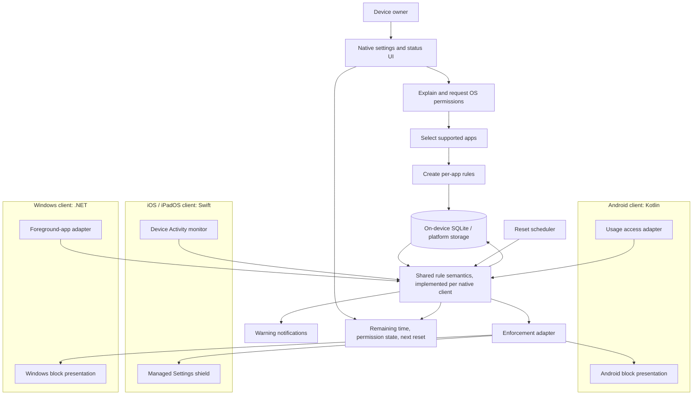

# Architecture and Runtime Workflow

## Design

MindGate is a set of local clients, not a web service that controls devices remotely. Each client has a settings interface, a small policy engine, a local database, a platform usage adapter, and a platform enforcement adapter. The policy contract is shared as a specification; app selection tokens remain platform-specific and local to the device.

## Runtime sequence

1. The user reads a short explanation and grants the relevant OS permissions or authorization.
2. The user selects apps through the platform picker or supported app list and creates rules.
3. The client stores the rules and current usage-cycle state on-device.
4. The platform adapter observes active use and reports time to the policy engine.
5. The engine updates the remaining budget and emits each configured warning once per cycle.
6. At zero remaining time, the native adapter applies the block and displays the next reset time.
7. At the reset boundary, the engine begins a new cycle and the adapter removes the block.
8. If permission or a background component is unavailable, the client reports that enforcement is paused and guides the user to restore it.

## Local data model

- **App rule:** platform, opaque platform selection reference, display label, allowance, warning thresholds, reset policy, enabled state.
- **Usage cycle:** rule ID, cycle start/end, active seconds counted, thresholds already notified, block state.
- **Permission state:** which OS capabilities are granted and when they were last checked.

The rule structure is defined in [`app-rule.v1.schema.json`](../contracts/app-rule.v1.schema.json). No backend is required for the first release. A later sync service would be optional and should sync settings only by default; platform app-selection references may need to be selected again on each device.

## Engineering boundaries

- The rule semantics should be the same across platforms, but enforcement code is native and platform-specific.
- The UI must not report a rule as enforced until the OS permission and enforcement adapter are active.
- Time calculations use explicit time zones and persisted cycle boundaries; test daylight-saving changes, clock changes, sleep, reboot, and offline use.
- Never block essential system functions. A permission-loss or crash recovery path must restore user control.
- Keep the first version local-first; avoid a server until a concrete cross-device requirement exists.
